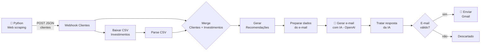

# Processo_RPA_N8N_Python_Dio
Automação que coleta dados de clientes na web (RPA/web scraping), cruza com um catálogo de produtos de investimento, aplica regras de negócio de recomendação por perfil e saldo e usa IA generativa (OpenAI) para escrever e enviar e-mails personalizados via Gmail.
# 🤖 Assistente de Investimentos com RPA + n8n + IA

Automação que **coleta dados de clientes na web (RPA/web scraping)**, cruza com um **catálogo de produtos de investimento**, aplica **regras de negócio de recomendação por perfil e saldo** e usa **IA generativa (OpenAI)** para escrever e **enviar e-mails personalizados** via Gmail.

> Trabalho de conclusão desenvolvido na **DIO (Digital Innovation One)**.
> ⚠️ Projeto **educacional**. Os dados são fictícios e as mensagens **não constituem recomendação de investimento**.

---

## 📌 Sumário

- [Visão geral](#-visão-geral)
- [Arquitetura](#-arquitetura)
- [Tecnologias](#-tecnologias)
- [Estrutura do repositório](#-estrutura-do-repositório)
- [Fontes de dados](#-fontes-de-dados)
- [Como funciona (nó a nó)](#-como-funciona-nó-a-nó)
- [Regras de recomendação](#-regras-de-recomendação)
- [Como executar](#-como-executar)
- [Resultado esperado](#-resultado-esperado)
- [Solução de problemas](#-solução-de-problemas)
- [Segurança e boas práticas](#-segurança-e-boas-práticas)
- [Melhorias futuras](#-melhorias-futuras)
- [Autor](#-autor)

---

## 🎯 Visão geral

**Problema:** assessores de investimento gastam tempo montando manualmente mensagens para cada cliente, cruzando perfil, saldo e produtos disponíveis.

**Solução:** um fluxo automatizado que:

1. **Extrai** a lista de clientes (nome, e-mail, saldo, perfil) de uma página web com Python.
2. **Envia** os dados ao **n8n** por webhook.
3. **Lê** o catálogo de produtos (`data.csv`) e **cruza** com cada cliente.
4. **Escolhe** o produto mais adequado ao perfil e ao saldo.
5. **Gera** um e-mail personalizado com IA, respeitando regras de conformidade (sem promessas de ganho).
6. **Valida** o e-mail do destinatário e **envia** pelo Gmail.

---

## 🏗 Arquitetura



> 💡 Dica: adicione um print do workflow em `docs/workflow.png` e referencie aqui:
> ``

---

## 🧰 Tecnologias

| Camada | Tecnologia |
|---|---|
| Orquestração / automação | [n8n](https://n8n.io) (self-hosted, Docker) |
| Coleta de dados (RPA) | Python 3, `requests`, `BeautifulSoup4` |
| Lógica de negócio | JavaScript (nós *Code* do n8n) |
| IA generativa | OpenAI (nó *Message a model*, modelo GPT-5) |
| Envio de e-mail | Gmail (OAuth2) |
| Fonte de dados | GitHub Pages (HTML + CSV) |

---

## 📁 Estrutura do repositório

```
.
├── README.md
├── requirements.txt
├── scripts/
│   └── enviar_clientes.py                     # scraping + envio ao webhook
└── workflows/
    └── assistente_investimentos_workflow.json # workflow para importar no n8n
```

---

## 🗂 Fontes de dados

### 1. Clientes (HTML)
Tabela publicada em
[`digitalinnovationone.github.io/dio-lab-assistente-investimentos-rpa-n8n`](https://digitalinnovationone.github.io/dio-lab-assistente-investimentos-rpa-n8n/)

| Nome | Email | Saldo | Perfil |
|---|---|---|---|
| Ana Silva | ana@email.com | R$ 12.500,00 | Conservador |
| Bruno Lima | bruno@email.com | R$ 3.200,00 | Moderado |
| ... | ... | ... | ... |

### 2. Produtos (CSV)
[`data.csv`](https://digitalinnovationone.github.io/dio-lab-assistente-investimentos-rpa-n8n/data.csv)

| perfil | produto | minimo | rentabilidade |
|---|---|---|---|
| Conservador | Poupança | 100 | 6.2% |
| Conservador | CDB Liquidez Diária | 1000 | 12.5% |
| Conservador | Tesouro Selic | 500 | 13.0% |
| Moderado | CDB Prefixado | 1000 | 14.0% |
| Moderado | Fundo Multimercado | 5000 | 16.0% |
| Moderado | Tesouro IPCA+ | 1000 | IPCA+6.0% |
| Arrojado | Ações ETF | 500 | Variável |
| Arrojado | Fundo de Ações | 10000 | Variável |
| Arrojado | Criptomoedas | 100 | Variável |

### Payload enviado ao webhook

```json
{
  "clientes": [
    { "nome": "Ana Silva", "email": "ana@email.com", "saldo": "R$ 12.500,00", "perfil": "Conservador" }
  ]
}
```

---

## ⚙️ Como funciona (nó a nó)

| # | Nó | Função |
|---|---|---|
| 1 | **Webhook Clientes** | Recebe o `POST /clientes` com a lista de clientes. Responde `200` imediatamente (modo *Immediately*) para o Python não ficar esperando o envio dos e-mails. |
| 2 | **Baixar CSV Investimentos** | `GET` no `data.csv`, resposta em texto no campo `data`. |
| 3 | **Parse CSV Investimentos** | Converte o CSV em lista de objetos e normaliza `minimo` para número. |
| 4 | **Merge Clientes + Investimentos** | *Combine by Position*: junta o item do webhook (clientes) com o item do CSV (investimentos) em um único item. |
| 5 | **Gerar Recomendações** | Converte o saldo (`"R$ 12.500,00"` → `12500`), filtra produtos compatíveis e escolhe o recomendado. Gera 3 variações de mensagem-base e sorteia uma. |
| 6 | **Preparar Dados do E-mail** | Cria **um item por cliente** com `email_to`, nome, perfil, recomendação, mensagem-base e regras de copy. |
| 7 | **Gerar E-mail com IA** | Envia os dados do cliente à OpenAI e pede um JSON com `subject`, `text_body` e `html_body`. |
| 8 | **Tratar Resposta da IA** | Extrai o texto da resposta, faz o `JSON.parse` e monta o item final. Se a IA falhar, usa a mensagem-base como **fallback** (nunca envia e-mail vazio). |
| 9 | **E-mail válido?** | Valida o destinatário por regex. E-mails inválidos são descartados. |
| 10 | **Enviar E-mail (Gmail)** | Envia o e-mail em HTML ao cliente. |

---

## 📐 Regras de recomendação

1. O **perfil** do cliente deve ser igual ao perfil do produto (comparação sem diferenciar maiúsculas/minúsculas).
2. O **valor mínimo** do produto deve ser **menor ou igual** ao saldo do cliente.
3. Entre os produtos compatíveis, escolhe-se o de **maior valor mínimo**.
4. Se nenhum produto for compatível, o motivo é `saldo_insuficiente` e a mensagem informa isso ao cliente.

### Recomendações geradas com os dados de exemplo

| Cliente | Perfil | Saldo | Produto recomendado |
|---|---|---|---|
| Ana Silva | Conservador | R$ 12.500,00 | CDB Liquidez Diária |
| Bruno Lima | Moderado | R$ 3.200,00 | CDB Prefixado |
| Carla Souza | Arrojado | R$ 28.900,00 | Fundo de Ações |
| Daniel Oliveira | Conservador | R$ 850,00 | Tesouro Selic |
| Elena Rodrigues | Arrojado | R$ 45.000,00 | Fundo de Ações |
| Felipe Santos | Moderado | R$ 7.800,00 | Fundo Multimercado |
| Gabriela Costa | Conservador | R$ 1.500,00 | CDB Liquidez Diária |
| Henrique Alves | Moderado | R$ 22.300,00 | Fundo Multimercado |
| Isabela Martins | Conservador | R$ 500,00 | Tesouro Selic |
| João Pereira | Arrojado | R$ 15.000,00 | Fundo de Ações |

### Regras de conformidade do e-mail (prompt da IA)

- Nunca prometer ganhos nem garantir rentabilidade.
- Sem linguagem agressiva ou urgência artificial.
- Tom amigável e profissional, 4 a 6 linhas, em pt-BR.
- Resposta **somente em JSON** válido (`subject`, `text_body`, `html_body`).

---

## 🚀 Como executar

### Pré-requisitos

- [Docker](https://docs.docker.com/get-docker/)
- Python 3.9+
- Conta OpenAI com **API key**
- Conta Google (Gmail) com **credenciais OAuth2**

### 1. Abrir o Workflow no N8N

### 2. Importar o workflow

1. No n8n, crie um novo workflow.
2. Menu **⋯ → Import from File** e selecione `workflows/assistente_investimentos_workflow.json`.

### 3. Configurar as credenciais

| Credencial | Onde usar | Como obter |
|---|---|---|
| **OpenAI API** | nó *Gerar E-mail com IA* | Chave em [platform.openai.com/api-keys](https://platform.openai.com/api-keys) |
| **Gmail OAuth2** | nó *Enviar E-mail (Gmail)* | Projeto no Google Cloud Console, com a **Gmail API** ativada e um *OAuth Client ID*. Em local, a URI de redirecionamento é `http://localhost:5678/rest/oauth2-credential/callback` |

### 4. Instalar as dependências do Python

```bash
python -m venv .venv
source .venv/bin/activate        # Windows: .venv\Scripts\activate
pip install -r requirements.txt
```

### 5. Executar (modo teste)

1. No n8n, abra o nó **Webhook Clientes** e clique em **Listen for test event**.
2. **Logo em seguida**, rode:

```bash
python scripts/enviar_clientes.py
```

O Python deve imprimir `Status: 200`, e o n8n executa o restante do fluxo.

> No modo teste o webhook escuta **apenas uma requisição por clique**. Para rodar de novo, clique em *Listen for test event* outra vez.


## ✅ Resultado esperado

**Saída do Python**

```
Clientes encontrados: 10
{'nome': 'Ana Silva', 'email': 'ana@email.com', 'saldo': 'R$ 12.500,00', 'perfil': 'Conservador'}
...
Status: 200
Resposta: {"message":"Workflow was started"}
```

**Item gerado pelo nó *Tratar Resposta da IA***

```json
{
  "ok": true,
  "to": "ana@email.com",
  "subject": "Uma opção de investimento para o seu perfil",
  "text_body": "Olá, Ana! ...",
  "html_body": "<p>Olá, <strong>Ana</strong>! ...</p>",
  "ia_ok": true,
  "meta": {
    "nome": "Ana Silva",
    "perfil": "Conservador",
    "produto": "CDB Liquidez Diária",
    "minimo": 1000,
    "rentabilidade": "12.5%",
    "motivo": "saldo_ok"
  }
}
```

---

## 🛠 Solução de problemas

| Sintoma | Causa provável | Solução |
|---|---|---|
| `Failed to resolve 'host.docker.internal'` | Container sem o alias do host (Linux) | Usar `--add-host=host.docker.internal:host-gateway` ou o nome do serviço/IP do gateway |
| `404 ... webhook is not registered` | Webhook em modo teste sem escutar | Clicar em **Listen for test event** antes de rodar, ou ativar o workflow e usar `/webhook/` |
| `Connection refused` | Porta 5678 não publicada ou n8n parado | Subir o n8n com `-p 5678:5678` |
| `Clientes encontrados: 0` | Seletor não achou a tabela | Verificar `soup.select("table tbody tr")` e se a tabela está no HTML bruto |
| E-mail com assunto genérico e texto simples | A IA falhou ou retornou JSON inválido (usou o fallback) | Ver o campo `ia_ok` e o output do nó OpenAI |
| Erro de credencial no nó OpenAI | Credencial não configurada | Criar/selecionar a credencial *OpenAI API* |
| Nenhum e-mail enviado | Destinatário reprovado na validação | Conferir o campo `to` e o regex do nó *E-mail válido?* |

---

## 🔒 Segurança e boas práticas

- **Nunca** versione chaves de API ou tokens. As credenciais ficam no n8n, e o JSON exportado **não contém segredos**.
- Os e-mails da base de exemplo (`@email.com`) são fictícios, mas o domínio pode existir de fato. **Ao testar, use endereços seus** para não enviar mensagens a terceiros.
- Em produção, proteja o webhook com **autenticação** (Header Auth/Basic Auth) e HTTPS.
- Dados financeiros e e-mails são **dados pessoais**. Considere a **LGPD**: finalidade, minimização e consentimento.
- A IA é instruída a não prometer rentabilidade. Mesmo assim, **revise os textos** antes de uso real.

---

## 🔭 Melhorias futuras

- [ ] Autenticação no webhook e uso de HTTPS.
- [ ] Registrar os envios em planilha/banco (auditoria).
- [ ] Notificação de falhas (Slack/Telegram) via *Error Trigger*.
- [ ] Aprovação humana antes do envio.
- [ ] Trocar a fonte HTML por API/banco de dados.
- [ ] Agendamento (*Schedule Trigger*) para execução periódica.
- [ ] Testes automatizados para as regras de recomendação.

---

## 👤 Autor

**Jorge Bento**

---

## 📄 Licença

Distribuído sob a licença MIT. Veja o arquivo `LICENSE` para mais detalhes.
